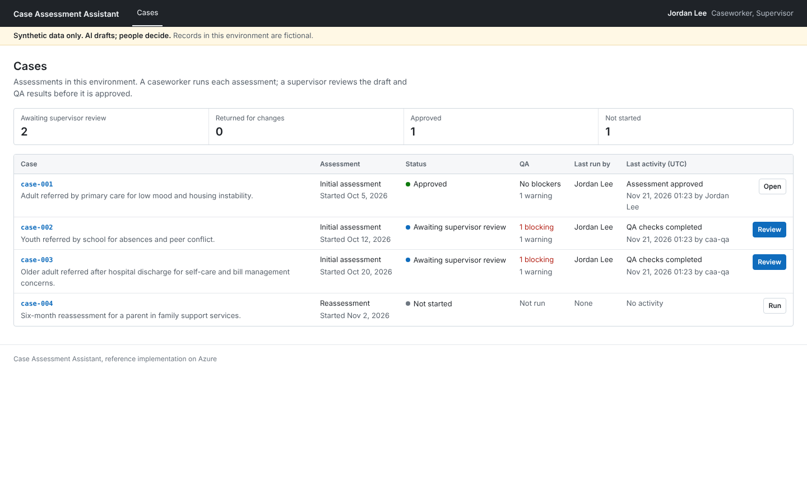
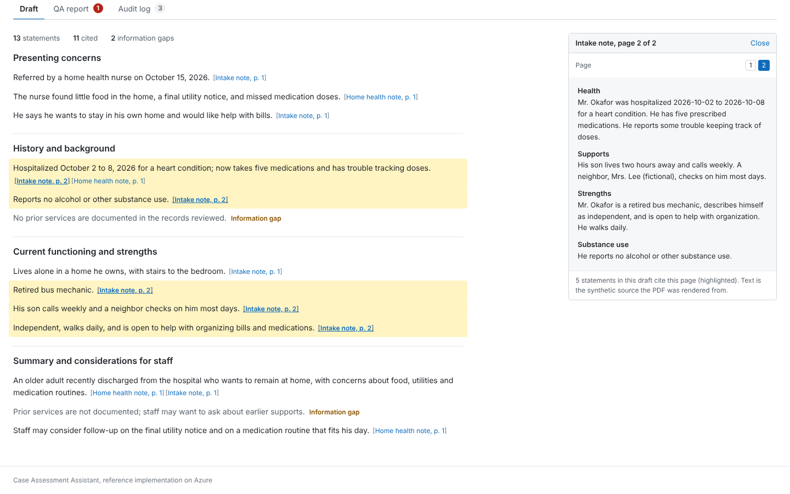
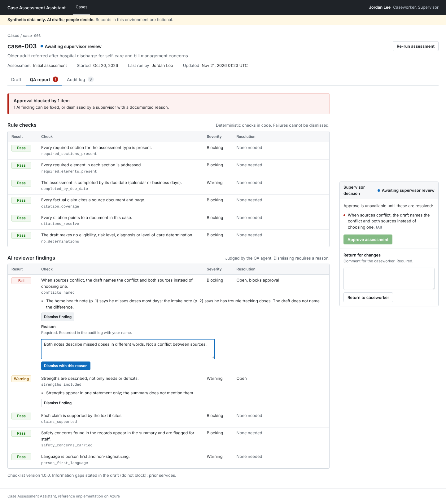
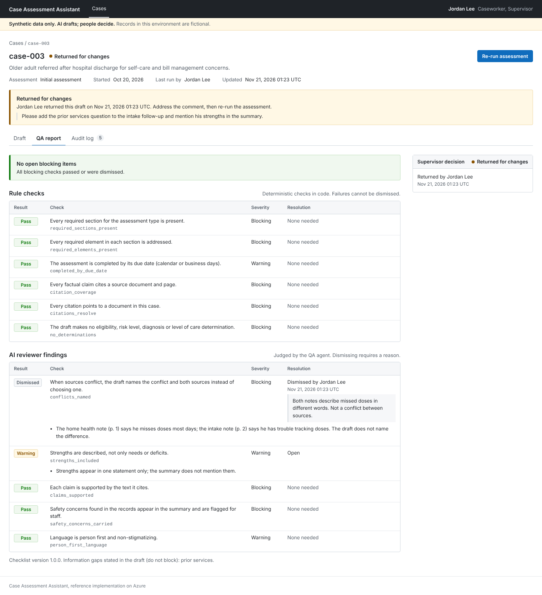
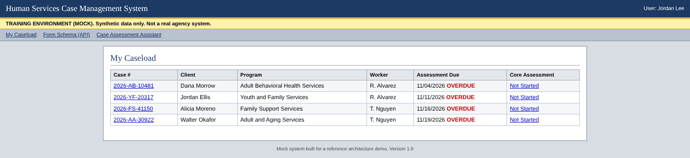
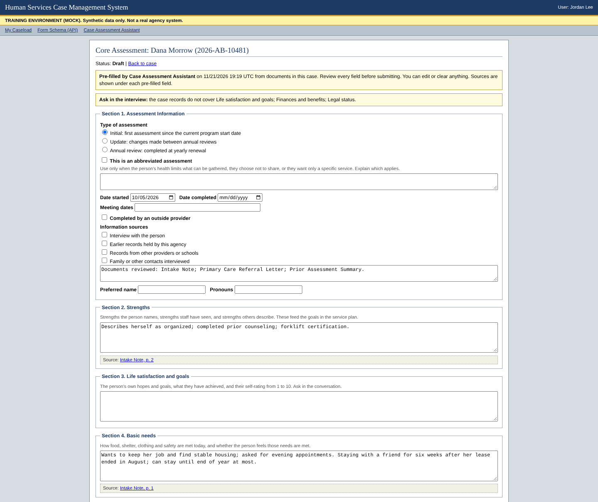
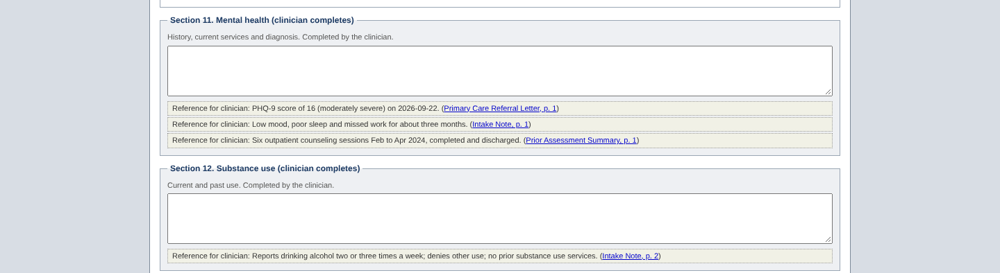
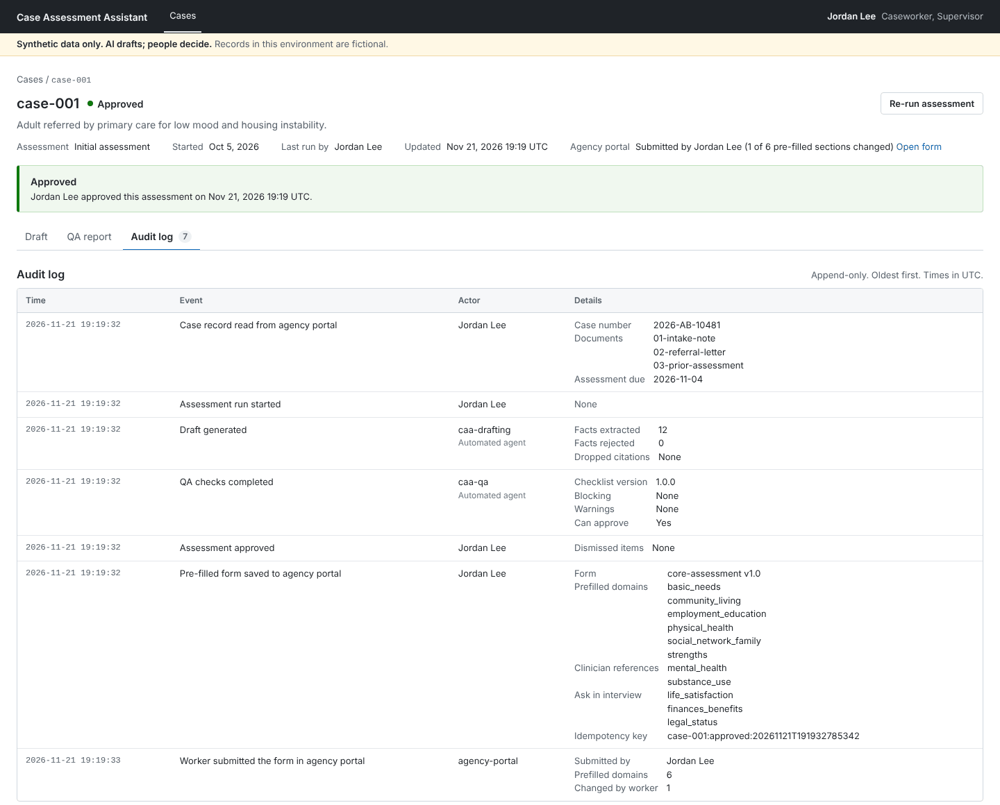

# Case Assessment Assistant

[](https://github.com/albitusha-create/case-assessment-assistant/actions/workflows/ci.yml)

An Azure-native reference implementation of an AI-assisted case assessment workflow for county human services and behavioral health programs. AI extracts facts with citations, drafts assessment sections, and checks drafts against a QA checklist. Staff review, edit and approve everything. **AI never makes clinical or eligibility decisions.**

> This repo uses **synthetic data only**. It contains no real people, agencies or protected health information, and it is not a compliance certification.

## The problem

Caseworkers spend hours reviewing large case files, writing assessment narratives, and responding to QA reviews that vary from reviewer to reviewer. Late assessments affect billing compliance and, more importantly, delay services.

## The workflow

1. **Ingestion:** case documents (intake notes, school and health records, prior assessments) are laid out by Document Intelligence, chunked by page, embedded and indexed. In this repo a seed script loads the synthetic cases.
2. **Extraction:** structured facts are pulled out, each tied to the chunk, document and page it came from. Facts that cite a chunk outside the case are rejected in code.
3. **Drafting agent:** drafts the assessment sections. Every factual claim cites its source; missing information is stated as a gap, never filled in.
4. **QA:** rule checks run in code (sections, required elements, citations, deadline, no determinations). The QA agent judges what code cannot (claims supported by their sources, conflicts named, safety concerns carried, person-first language, strengths). Severity comes from the checklist, never from the model, and an item the agent does not report fails.
5. **Human review:** a caseworker runs the case; a supervisor approves or returns it with a comment. A supervisor may dismiss an AI-judged finding with a written reason. Rule failures cannot be dismissed. Every step lands in an append-only audit log.

## Fits into the system workers already use

Workers finish the assessment in their agency's case management system, not here. The assistant reads the case from that system, and after a supervisor approves, saves a pre-filled draft of the agency's form back into it, with a source under each section. The worker reviews, edits and submits there. Clinical sections stay with the clinician, and sections the records do not cover become topics to ask about in the interview. While the worker writes in the portal, a **Check with assistant** button under each section runs the QA checklist on their text and lists facts from the case documents they can insert, each with its source ([ADR 0007](docs/adr/0007-assist-the-worker-inside-the-portal.md)). The repo includes a mock agency portal at `/portal` (synthetic data, a generic form) to show this end to end, over a REST API and as MCP tools. See [ADR 0006](docs/adr/0006-integrate-with-the-system-of-record.md) and the [integration diagram](docs/architecture.md#integration-the-agencys-system-of-record).

## Screenshots

Synthetic case-003 in the assistant. Each draft statement links to the cited page of its source document; the QA report separates rule checks (cannot be dismissed) from AI reviewer findings (a supervisor may dismiss one with a documented reason).

| Case list | Draft with the cited source page |
| --- | --- |
|  |  |

| QA report with dismiss form | Returned for changes |
| --- | --- |
|  |  |

### Agency portal integration

The mock agency portal at `/portal` stands in for the system workers already use. After a supervisor approves case-001, the assistant saves a pre-filled draft of the portal's form over the REST API. The worker edits and submits it there, and the assistant's audit log records the submit.

| Portal caseload | Pre-filled form with a source under each section |
| --- | --- |
|  |  |

| Clinician sections get references, never pre-filled text | Audit log after the worker submits in the portal |
| --- | --- |
|  |  |

## Design principle: deterministic rules, LLM judgment

Business rules (required sections, checklist logic, deadline calculations) are plain Python with unit tests. The agents call them as tools. The LLM handles interpretation, drafting and synthesis only.

## Architecture

See [docs/architecture.md](docs/architecture.md) for the component diagram and request flow.

## Azure services and why

| Service | Role |
| --- | --- |
| Microsoft Foundry Agent Service | Hosts the Drafting and QA agents, tracing and evaluations |
| Azure AI Document Intelligence | Layout extraction with page numbers for citations |
| Azure AI Search | Hybrid (keyword + vector) retrieval, filtered per case |
| Azure Blob Storage | Uploaded documents |
| Azure Cosmos DB | Cases, drafts and the append-only audit log |
| Azure Container Apps | Runs the FastAPI app and UI |
| Azure API Management (optional) | AI gateway: token limits and usage metrics. Off by default to save cost; turn on with `DEPLOY_APIM=true` |
| Microsoft Entra ID, managed identity, Key Vault | Sign-in, roles, keyless service access |
| Application Insights | Telemetry and traces |

Details and tradeoffs live in the [ADRs](docs/adr/).

## Security and compliance model

See [docs/security-compliance.md](docs/security-compliance.md).

## Evaluation approach

The synthetic cases carry ground truth: the facts a careful reader should find (with document and page) and the elements each case deliberately leaves undocumented.

- **Extraction recall** (`evals/extraction_recall.py`): share of planted facts found with the right element, document and page, and a count of facts that "fill" a planted gap. The gate is recall of at least 0.8 and zero false fills. The latest deploy run scored 0.92 with zero false fills.
- **Deterministic checks** (unit tests): rules, citation resolution, fail-closed QA, the approval gate and the audit trail are tested without a model.
- **CI gate:** the deploy workflow runs the recall eval and does not deploy if it fails.

Model output varies from run to run, so one run is a sample, not a score. See [evals/README.md](evals/README.md).

## Cost

See [docs/cost.md](docs/cost.md).

## Deploy and tear down

Prerequisites: an Azure subscription where you can assign roles, the Azure CLI, the Azure Developer CLI (`azd`), Docker, `uv` and the GitHub CLI. Check model quota for the chat and embedding models in your region first (see [infra/README.md](infra/README.md)).

```bash
azd env new caa-dev
azd env set AZURE_LOCATION eastus2
azd provision                      # about 15 minutes the first time
azd env get-values > .env
uv run python scripts/seed_data.py # load the synthetic cases
uv run python -m caa.agents publish
azd deploy                         # build and roll out the web app
./scripts/entra_app.sh             # sign-in app registration and roles
azd provision                      # turns sign-in on
```

Optional:

- `azd env set DEPLOY_APIM true && azd provision` puts API Management in front of model calls (30 to 45 minutes, billed hourly). `./scripts/apim_off.sh` removes it.
- `./scripts/github_oidc.sh` sets up the GitHub Actions deploy with OIDC.

Tear down with `./scripts/teardown.sh`. It deletes the resource group and purges soft-deleted resources. Details are in [infra/README.md](infra/README.md).

## Local development

```bash
uv sync
uv run pytest
uv run uvicorn caa.main:create_app --factory --reload   # http://127.0.0.1:8000
```

After `azd provision`, load the synthetic cases into Azure:

```bash
azd env get-values > .env              # endpoints and names only, no keys
uv run python scripts/seed_data.py     # blob, layout, chunk, embed, index
uv run pytest -m integration           # every search hit stays inside its case
uv run python -m caa.extraction case-001   # cited facts for one case
uv run python evals/extraction_recall.py   # recall against the planted facts
uv run python -m caa.agents publish         # create or update both agents in Foundry
uv run python -m caa.agents draft case-002  # extract, then draft with citations
uv run python -m caa.agents review case-002 # extract, draft, then QA gap report
```

### Agency portal (mock) and MCP tools

With the app running locally:

- Open http://127.0.0.1:8000/portal for the worker's view of the agency system.
- The portal API is at `/portal/api/v1` (schema at `/portal/api/v1/forms/core-assessment/schema`). With no `PORTAL_API_KEY` set locally, it needs no key.
- Connect an MCP client to the tools: `http://127.0.0.1:8000/mcp` (Streamable HTTP; any MCP client that supports it, for example as a server named `agency-portal`)

Demo flow (see the [portal screenshots](#agency-portal-integration)): in the portal, open a case and show the empty form. In the assistant, run the case and approve it. Back in the portal, the form is a pre-filled draft with sources. Edit a section and click **Check with assistant** under it: the QA checklist runs on your text and lists facts from the case documents you can insert. Tick the attestation and submit. The assistant's audit log then shows the section checks, the inserted facts, the submit and how many pre-filled sections the worker changed.

## Production next steps

This is a reference implementation. Before real use, at minimum:

- **Data and compliance:** a legal and privacy review for the program's rules (for example HIPAA, 42 CFR Part 2 for substance use records, state law), retention and deletion policies, and Data Zone or regional model deployments where data residency matters.
- **Network isolation:** private endpoints for every data service, public network access off, Container Apps in a virtual network, and API Management in a tier that supports internal networking.
- **Separation of duties:** today one demo user holds both roles. Production should stop a person from approving a case they ran, and review role assignments regularly.
- **Gateway coverage:** agent model calls go from the Foundry project to its models directly, so they skip the API Management token limits. Route them through a gateway or set limits at the deployment.
- **Evaluation:** average several runs per change, add drafting and QA evals with human-labeled examples, and track the QA judge's false-positive rate. Supervisors' dismissal reasons are a ready source of labels.
- **Least privilege:** scope the CI identity to the resource group, narrow data roles per component, and switch Application Insights ingestion to Entra auth.
- **Ingestion:** a document upload flow with a queue and background jobs, and better section detection in layout output.
- **Audit:** export the audit log to immutable storage, and add Content Safety prompt shields on document text.

## License

[MIT](LICENSE)
