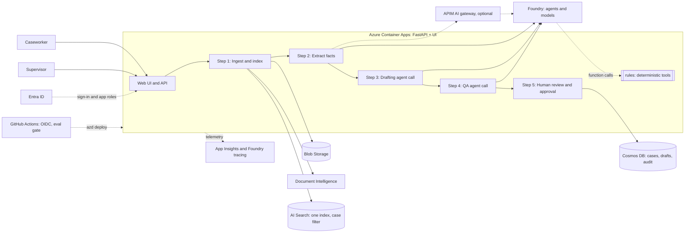
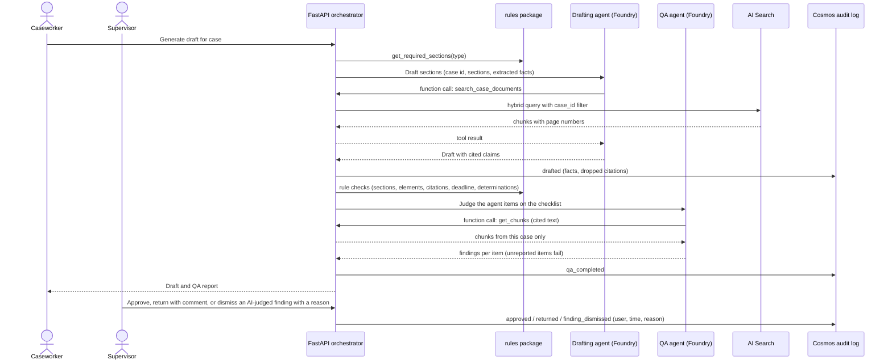

# Architecture

## Components

Only steps 3 and 4 are agents. Ingestion, extraction orchestration, rules and approval are deterministic code or a human step. All service calls use a managed identity. API Management is optional (dashed): it is off by default to save cost, and `DEPLOY_APIM=true` puts it in front of direct model calls (extraction and embeddings).

## Request flow: generate and review a draft

