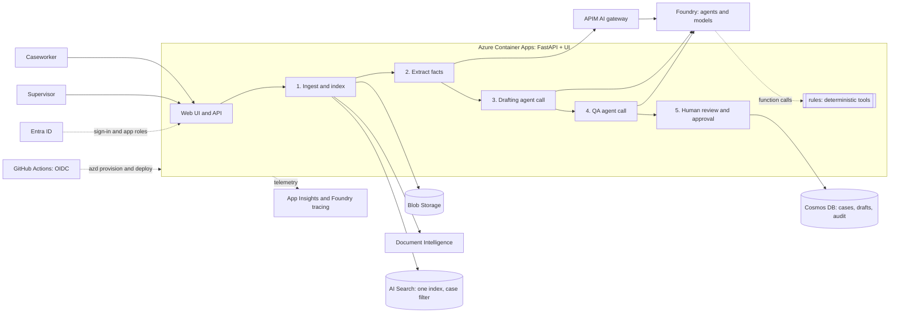
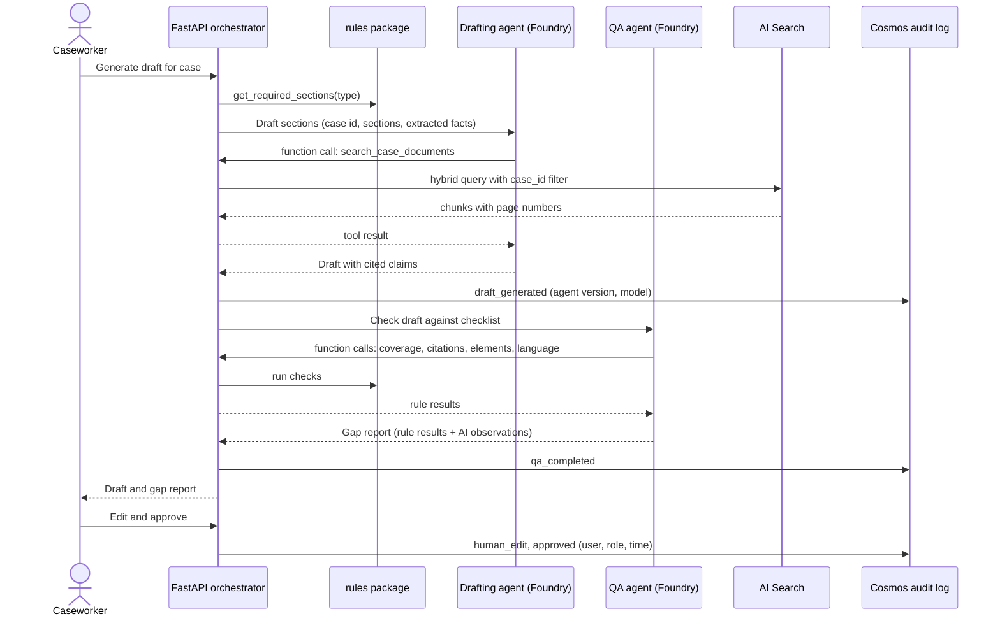

# Architecture

## Components

Only steps 3 and 4 are agents. Ingestion, extraction orchestration, rules and approval are deterministic code or a human step. All service calls use a managed identity.

## Request flow: generate and review a draft

