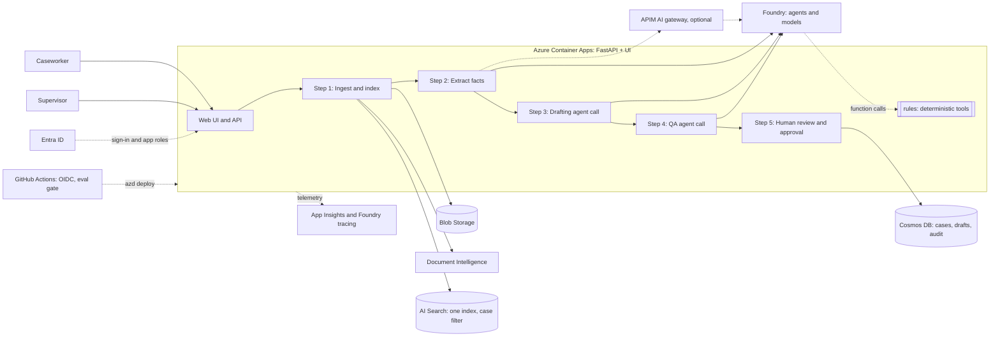
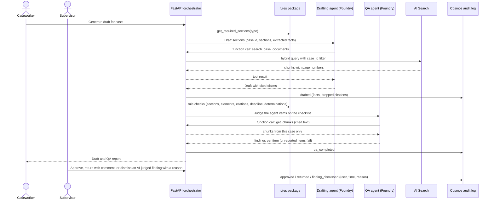
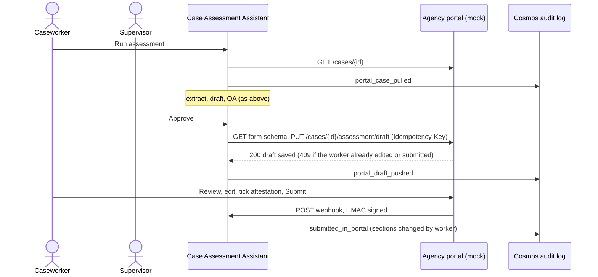

# Architecture

## Components

Only steps 3 and 4 are agents. Ingestion, extraction orchestration, rules and approval are deterministic code or a human step. All service calls use a managed identity. API Management is optional (dashed): it is off by default to save cost, and `DEPLOY_APIM=true` puts it in front of direct model calls (extraction and embeddings).

## Request flow: generate and review a draft

## Integration: the agency's system of record

Workers submit the assessment in the agency's own case management system, not in this app. The repo includes a mock of that system at `/portal` (its own pages, state and REST API v1) and integrates with it as a client. See [ADR 0006](adr/0006-integrate-with-the-system-of-record.md).

- **No submit in the API.** Only a signed-in worker submits, in the portal.
- **Portal-side rules** hold for every caller: clinical sections and the self-rating cannot be pre-filled, a form the worker edited or submitted is never overwritten, and saves are idempotent.
- **MCP tools** at `/mcp` wrap the same client: four read tools and `portal_send_approved_draft(case_id)`, which runs the approval check. The endpoint answers only requests addressed to localhost.
- **In Azure** the mock runs in the same container. The client calls it over `127.0.0.1`, so Easy Auth, which guards ingress, is not in the path. `PORTAL_BASE_URL` points the same client at a real external system.
